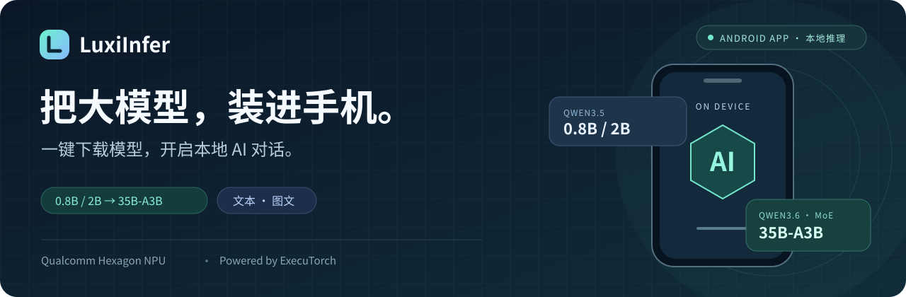
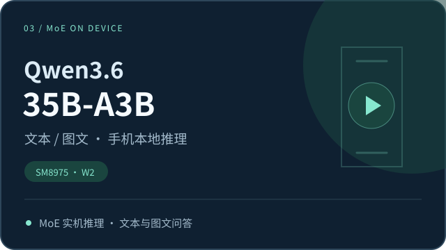
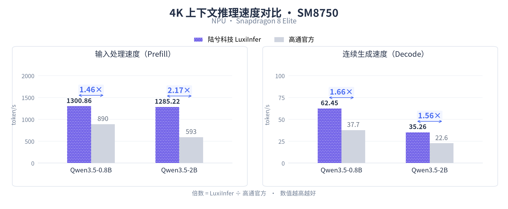
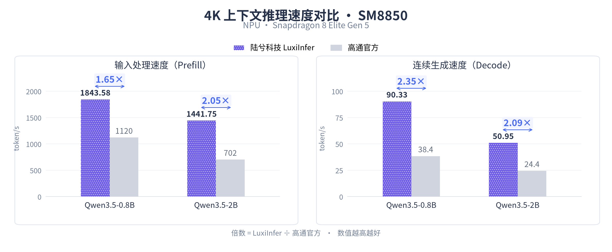

<p align="center">
  
</p>

<div align="center">

**从 0.8B/2B 小模型高性能推理，到 35B MoE 大模型高效部署，以自研核心算子、超低比特量化和动态专家调度，突破移动端计算与存储瓶颈。**

[🎬 实机演示](#demo) · [📥 下载 App](#download) · [🌟 核心能力](#features) · [⚡ 性能表现](#performance) · [🧩 技术方案](#technology) · [🛠️ 开发者](#developers)

</div>

LuxiInfer 是陆兮科技面向高通移动平台的 **Android 本地 AI 应用**。在 App 内选择模型、**一键下载**并加载对话，即可在手机上运行 Qwen3.5-0.8B / 2B 和 Qwen3.6-35B-A3B，体验本地文本生成与图文问答。

<a id="demo"></a>

## 🎬 实机演示

从 0.8B / 2B 小模型到 35B MoE，展示手机上的真实输入处理、流式生成与图文问答。

<table>
  <tr>
    <td width="50%" align="center">
      <!-- DEMO_SMALL_MODEL_URL：替换为小模型实机视频地址。 -->
      <a href="DEMO_SMALL_MODEL_URL"></a>
      <br /><b>0.8B / 2B：输入处理与连续生成</b>
      <p>查看 GDN 加速下的长文本处理、流式回答与运行速度。</p>
    </td>
    <td width="50%" align="center">
      <!-- DEMO_MOE_URL：替换为 Qwen3.6-35B-A3B 实机视频地址。 -->
      <a href="DEMO_MOE_URL"></a>
      <br /><b>35B MoE：手机本地大模型推理</b>
      <p>查看 Qwen3.6 的材料问答、图片理解与持续生成。</p>
    </td>
  </tr>
</table>

<!-- DEMO_APP_URL：替换为 App 完整体验视频地址。 -->
<p align="center">
  <a href="DEMO_APP_URL"></a>
</p>
<p align="center"><b>App 完整体验：模型库 → 一键下载 → 加载模型 → 本地对话</b></p>

<a id="download"></a>

## 📥 下载与使用

<!-- APK_DOWNLOAD_URL：替换为 Android 安装包下载地址。 -->
<p align="center"><a href="APK_DOWNLOAD_URL"><b>下载 LuxiInfer Android App</b></a></p>

1. **安装 LuxiInfer。** 在 Android 手机上安装并打开 App。
2. **一键下载模型。** 进入模型库，选择所需模型并下载配套模型包。
3. **加载并对话。** 模型就绪后输入文字或图片，查看本地流式回答。

模型下载需要网络，推理在设备本地执行。小模型与 MoE 使用同一个 App，模型获取、加载和对话均在 App 内完成。

### 模型与平台

| 模型 | 规模 | 已测芯片平台 |
| :--- | :--- | :--- |
| Qwen3.5-0.8B | 0.8B | SM8750（8 Elite）、SM8850（8 Elite Gen 5） |
| Qwen3.5-2B | 2B | SM8750（8 Elite）、SM8850（8 Elite Gen 5） |
| Qwen3.6-35B-A3B | 35B 总参数 / 约 3B 激活参数 | SM8975 |

<a id="features"></a>

## 🌟 核心能力

- 📱 **模型一键获取。** 在同一个 App 内完成模型选择、下载与加载，快速开启手机本地对话。
- ⚡ **高通 NPU 原生加速。** 基于 ExecuTorch 与 Qualcomm Hexagon NPU，以自研 GDN 算子加速 0.8B / 2B 小模型，并为 MoE 混合注意力计算提供基础。
- 🧠 **35B MoE 手机推理。** 支持 Qwen3.6-35B-A3B 文本与图文任务，在手机上运行数百亿参数大模型。
- 💾 **低内存部署。** 结合 2-bit 专家存储、按需加载与动态缓存，协同优化权重读取、内存占用和计算效率。

<a id="performance"></a>

## ⚡ 性能表现

### 🚀 Qwen3.5-0.8B / 2B：4K 上下文推理加速

**4K 上下文下，Prefill 速度最高达到高通官方方案的 2.17 倍（提升 116.70%），Decode 速度最高达到 2.35 倍（提升 135.20%）。** 两项最高值分别对应不同平台与模型。

下图为 **4K 上下文**下的推理速度对比：**Prefill** 表示输入处理，**Decode** 表示连续生成，单位均为 token/s。紫色为 LuxiInfer，灰色为高通官方；柱顶标出速度，箭头上方标出两者的速度比。

**SM8750 · Snapdragon 8 Elite · 4K 上下文**



**SM8850 · Snapdragon 8 Elite Gen 5 · 4K 上下文**



在 SM8750 上，2B 模型的 Prefill 达到高通官方方案的 **2.17 倍**；在 SM8850 上，0.8B / 2B 模型的 Decode 分别达到 **2.35 倍 / 2.09 倍**。上述结果体现 GDN 算子与整模执行路径的协同优化效果。

<details>
<summary>📋 测试条件与高通官方数据来源</summary>

陆兮侧为 Q4 / NPU、约 4K 输入；高通官方数据采用 Q4_0 GGUF / GenieX-llama.cpp、4096 上下文的 NPU 条目。设备、量化细节与软件版本等条件存在差异，这些结果用于同档位参考对比。

**高通官方数据来源：** Qualcomm AI Hub，[Qwen3.5-0.8B 官方性能数据](https://github.com/qualcomm/ai-hub-models/blob/v0.65.0/src/qai_hub_models/models/qwen3_5_0_8b/perf.yaml)、[Qwen3.5-2B 官方性能数据](https://github.com/qualcomm/ai-hub-models/blob/v0.65.0/src/qai_hub_models/models/qwen3_5_2b/perf.yaml)。图中速度比按所展示数值计算并四舍五入，提升百分比沿用测试汇总记录。

</details>

### 🧠 Qwen3.6-35B-A3B：手机端 MoE 推理

在**不使用前瞻专家调度与投机解码技术**的情况下，LuxiInfer 通过 NPU 原生计算、专家缓存和异步读算交叠，实现高性能的手机端 35B MoE 推理：

- 🚀 **Decode 最高 13.58 tokens/s。** 在图文 256 → 256 token、每层 64 槽缓存配置下，实现连续生成，为手机端大模型问答提供实时交互能力。
- ⚡ **Prefill 吞吐突破 330 tokens/s。** 在纯文本 1024 → 1024 token 任务中，32 槽配置达到 **352.44 tokens/s**，64 槽配置达到 **332.09 tokens/s**，展现数百亿参数 MoE 的高性能输入处理能力。
- 💾 **纯文本峰值内存低至 3.801 GiB。** 在 256 → 256 token、32 槽配置下，通过专家按需加载降低运行内存占用。

**Prefill 已达到高通官方端侧 MoE 方案的相近吞吐量级。** 高通在[官方公告](https://www.qualcomm.cn/news/releases/2026/09/releases-2026-09-22-2)中披露，StepEdge-Omni 30B-MoE 通过 NPU+GPU 双引擎协同，预填充吞吐超过 **330 tokens/s**。LuxiInfer 的 Qwen3.6-35B-A3B 在 Hexagon NPU 推理路径上达到上述 **332.09–352.44 tokens/s**；两者为不同模型与执行配置下的吞吐量级对照。

#### 📊 详细测试结果

最高 Decode、最高 Prefill 和最低内存分别对应上文标明的测试配置。以下覆盖纯文本与图文任务，使用 **AR128、W2 专家版本**。每项数据按 **32 槽 / 64 槽**排列；槽数表示每层可缓存的专家数量，输入与输出长度单位为 token。

| 输入类型 | 输入 → 输出 | Prefill token/s（32 / 64 槽） | Decode token/s（32 / 64 槽） | 峰值内存 GiB（32 / 64 槽） |
| :--- | :---: | ---: | ---: | ---: |
| 纯文本 | 256 → 256 | 159.66 / 175.40 | 10.84 / 12.86 | 3.801 / 4.787 |
| 纯文本 | 512 → 512 | 272.56 / 301.47 | 10.91 / 12.89 | 3.848 / 4.924 |
| 纯文本 | 1024 → 1024 | 352.44 / 332.09 | 10.02 / 11.60 | 3.968 / 4.994 |
| 图文 | 256 → 256 | 91.03 / 119.20 | 11.30 / 13.58 | 4.411 / 5.429 |
| 图文 | 512 → 512 | 165.33 / 167.76 | 10.76 / 12.81 | 4.461 / 5.418 |
| 图文 | 1024 → 1024 | 265.63 / 251.90 | 9.81 / 12.19 | 4.529 / 5.509 |

32 槽配置在上述纯文本任务下的峰值内存为 **3.801–3.968 GiB**；64 槽以更多缓存空间换取这些负载下更高的生成速度。Prefill 收益与输入和专家复用情况有关，可按设备资源与任务选择缓存容量。

W2 指专家权重的 2-bit 索引存储，其余组件采用混合精度。运行峰值内存与设备物理内存要求需分别考虑；图文任务的首次响应还包含图片处理和视觉编码开销。

<a id="technology"></a>

## 🧩 技术方案

LuxiInfer 基于高通原生 AI 加速技术栈，以 **ExecuTorch 为推理执行底座**。先优化混合注意力模型的核心计算，再扩展到 MoE 专家权重的存储与运行时调度，形成从小模型到大参数模型的协同优化方案。

### GDN：打好小模型与 MoE 的计算基础

Gated DeltaNet（GDN）是混合注意力模型中的关键计算模块，通过门控与递推状态更新处理序列信息。它的执行效率直接影响模型的输入处理与连续生成速度，也是 LuxiInfer 从小模型扩展到 MoE 大模型的计算基础。

面向 Qwen3.5-0.8B / 2B，陆兮科技自研了适配 Hexagon NPU 的 **GDN 高性能融合算子**，围绕三个方向优化：

- 🧩 **融合计算：** 将关键递推计算与状态更新统一执行，减少算子拆分和中间张量搬运。
- ♻️ **复用状态：** 复用中间结果与工作状态，降低重复计算和内存读写开销。
- ⚡ **原生加速：** 结合 Hexagon 向量化与并行执行能力，提高 Prefill 和 Decode 的执行效率。

这套 GDN 执行能力同时用于后续 Qwen3.6 MoE 的混合注意力计算。GDN 部分公开方案概要与性能结果，核心源码不在开放范围内。

### MoE：协同优化计算、存储与调度

在 GDN 算子加速的基础上，Qwen3.6-35B-A3B 带来了新的部署挑战：虽然每次只激活部分专家，但完整权重仍需存放在设备上。模型规模增大后，**常驻内存、专家读取与加载等待**成为影响手机端推理的重要因素。

LuxiInfer 将专家存储、缓存管理与 NPU 计算结合起来，保留每层 256 个专家的真实 Top8 路由，通过五项优化降低内存与 I/O 开销：

1. **2-bit 专家量化。** 专家权重采用 `{-7, -2, 2, 7}` 四值码本，以 2-bit 索引压缩存储；执行时在 VTCM 中展开为 4-bit，配合 A8 激活，由 HVX 准备数据、HMX 执行矩阵乘。
2. **按需加载与动态缓存。** 每层使用 32 / 64 槽 LRU 缓存，命中时直接复用，缺失时从闪存读取，让完整专家集合按需参与计算，降低常驻内存需求。
3. **Prefill 权重复用。** 采用按层优先（layer-major）调度，同一层连续处理多个 AR128 输入块，并按专家归并 token，减少重复读取、提高矩阵计算利用率。
4. **Decode 读算交叠。** 优先计算命中专家，同时异步读取缺失专家；结合就绪调度与双缓冲，交叠权重搬运和当前计算，减少等待。
5. **跨阶段资源共享。** 融合 Attention 与 Router / Shared，Prefill / Decode 共享常量和常驻 context，并复用专家缓存，减少重复加载与复制。

<a id="developers"></a>

## 🛠️ 开发者

LuxiInfer 基于 ExecuTorch 与高通 AI 技术栈构建，工程提供量化、导出、设备推理与 Android JNI 集成入口。GDN 核心源码不在开放范围内，工程构建需要配套组件。

<details>
<summary>查看 MoE 工程入口与部署流程</summary>

以下路径相对于 ExecuTorch 源码根目录。完整环境与操作说明见 `examples/qualcomm/oss_scripts/moe/qwen35-35B-A3B/CONFIGURATION.md`。

```text
examples/qualcomm/oss_scripts/moe/qwen35-35B-A3B/
├── CONFIGURATION.md       # 环境、配置、导出与部署
├── export.py              # 统一导出入口
├── run_chat.py            # 设备推理与 Python 调用
├── build.sh               # runner / Native 组件构建
├── configs/               # 量化、容量与调度配置
├── quantization/          # GPTQ 与专家量化
├── export/                # QNN 图编译与组件导出
├── workflow/              # 导出编排、模型打包与部署
├── runner/                # 会话、专家缓存与异步 I/O
└── native/                # Hexagon HVX / HMX 专家内核

extension/android/jni/moe/ # Android JNI 集成
```

工程目录沿用 `qwen35-35B-A3B`，适配模型为 Qwen3.6-35B-A3B。先按配置文档准备 Python / CUDA、QNN、Hexagon、Android NDK 与设备运行库，并完成 ExecuTorch / QNN 基础库构建。导出配置需要设置实际 checkpoint、校准数据、SDK、设备及构建路径。

```bash
export MOE_ROOT="$PWD/examples/qualcomm/oss_scripts/moe/qwen35-35B-A3B"
export MOE_CONFIG="$MOE_ROOT/configs/export_sm8975.json"
export MOE_DEVICE="YOUR_ADB_SERIAL"
export MOE_OUT="$PWD/llama-output/luxiinfer-moe/pte"

python "$MOE_ROOT/export.py" --config "$MOE_CONFIG" --print-plan
python "$MOE_ROOT/export.py" --config "$MOE_CONFIG" --check
python "$MOE_ROOT/export.py" \
  --config "$MOE_CONFIG" --output "$MOE_OUT" \
  --soc-model SM8975 --device "$MOE_DEVICE"
```

配置驱动的入口串起 GPTQ、QNN 编译、共享权重分离与 PTE 打包。完整文本 PTE 导出需连接目标设备。最终模型交付文件为 `model.pte`，运行环境与平台库单独部署。

以下示例约定导出配置的 `build_dir` 为 `llama-output/luxiinfer-moe/build`，设备 QNN 库位于 `/data/local/tmp/qwen35-runtime-v85`：

```bash
python "$MOE_ROOT/run_chat.py" \
  --weights-path "$MOE_OUT/model.pte" \
  --build-dir "$PWD/llama-output/luxiinfer-moe/build" \
  --device "$MOE_DEVICE" --soc-model SM8975 \
  --runtime-device-dir /data/local/tmp/qwen35-runtime-v85 \
  --cache-experts 32 --temperature 0 --max-new-tokens 128 \
  --no-enable-thinking --interactive --stream \
  --prompt "你好，请用中文介绍一下自己。"
```

图文推理使用 `--image-path`，Android 集成使用 `Qwen35MoeModule`。配置字段、工具链版本、JNI 打包与排错步骤分别见工程内的 `CONFIGURATION.md` 和 `extension/android/jni/moe/README.md`。

复现上文 MoE 测试时，总上下文需配置为 2048，并导出匹配的模型图；工程默认值为 1152。上下文包含模板、文本、图片与输出，修改运行时参数不会扩大已有图的容量。

</details>

<a id="contact"></a>

## 🤝 交流与合作

欢迎通过项目 Issues 反馈机型适配、部署问题和性能记录。提交问题时请附手机 / SoC、系统版本、App / 模型版本、关键配置及运行日志。

面向手机、边缘设备与本地 AI 应用，陆兮科技提供模型适配、部署集成与性能优化的技术交流与合作。

- 技术交流与商务合作：[LuxiTech@luxitech.cn](mailto:LuxiTech@luxitech.cn)
- 陆兮科技：[GitHub · LuxiTech](https://github.com/LuxiTech)
- 相关项目：[LuxiChat-App](https://github.com/LuxiTech/LuxiChat-App)

感谢 ExecuTorch、Qualcomm AI 技术栈及 Qwen 开源模型社区。模型与第三方组件的来源、版本及许可说明见对应发布物。
