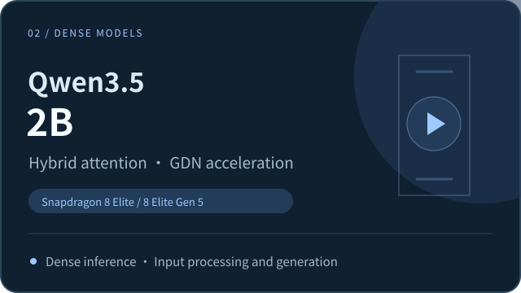
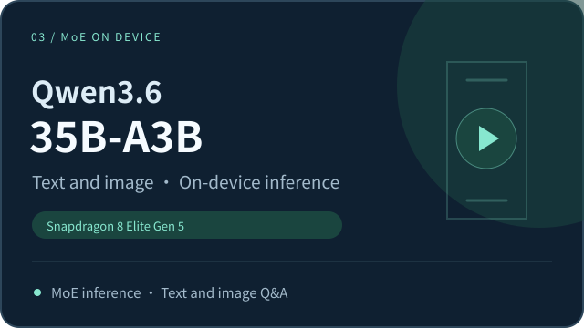

<h1 align="center">LuxiInfer</h1>

[简体中文](README.md) | **English**

**Efficient on-device inference for Dense and MoE models, overcoming mobile compute and storage bottlenecks with custom core operators, ultra-low-bit quantization, and dynamic expert scheduling.**

  

[🎬 Live Demos](#demo) · [🚀 Quick Start](#quick-start) · [📰 News](#news) · [⚡ Performance](#performance) · [🧩 Technology](#technology)

**LuxiInfer** is an on-device AI application and inference solution developed by LuxiTech for Qualcomm mobile platforms. It runs models of different architectures and sizes on phones, supporting text conversations and image understanding.

To address the growing diversity and size of models, LuxiInfer builds on **ExecuTorch and Qualcomm's native AI stack**. It brings together model adaptation, operator acceleration, low-bit quantization, storage management, and runtime scheduling into a complete, high-performance on-device inference solution.

- 📱 **One-tap download and offline inference:** Enjoy an out-of-the-box app experience. Select and download a model in the app to start text conversations and image-based interactions. Once the model is downloaded, inference runs entirely on the phone without an internet connection, protecting data privacy.
- ⚡ **Custom low-level operators make the most of the NPU:** For the Qualcomm Hexagon NPU, LuxiInfer combines a **custom fused GDN operator**, HVX vectorization, and model execution optimizations to address frequent scheduling and high memory-access overhead in hybrid-attention models running on general-purpose frameworks, significantly improving computational efficiency.
- 💾 **Coordinated compute and storage reduce resource use:** Low-bit quantization, dynamic caching, and asynchronous loading are tailored to each model to optimize weight storage, memory usage, and runtime scheduling, making large models practical on phones.
- 🧠 **One solution for multiple model architectures:** The same on-device inference solution supports both Dense and MoE architectures. Users can enjoy fast responses from a 2B model or run a 35B model on a phone for complex text and image-based tasks.

LuxiInfer will continue to expand support for model architectures and develop more general on-device operators, quantization, and runtime solutions for future hybrid architectures and local AI applications.

## 🎬 Live Demos

These demos use Qwen3.5-2B and Qwen3.6-35B-A3B to show input processing, streaming generation, and image-based question answering with Dense and MoE models on a phone.

<table>
  <tr>
    <td width="50%" align="center">
      <!-- DEMO_SMALL_MODEL_URL: Replace with the Dense model demo video URL. -->
      
       <b>Dense · Qwen3.5-2B: Input processing and continuous generation</b>
      
See long-text processing, streaming responses, and inference speed with GDN acceleration.

    </td>
    <td width="50%" align="center">
      <!-- DEMO_MOE_URL: Replace with the Qwen3.6-35B-A3B demo video URL. -->
      
       <b>MoE · Qwen3.6-35B-A3B: On-device large-model inference</b>
      
See Qwen3.6 answer questions about documents, understand images, and generate responses continuously.

    </td>
  </tr>
</table>

<!-- DEMO_APP_URL: Replace with the full app walkthrough video URL. -->

  

<b>Full app walkthrough: Model library → One-tap download → Load model → On-device chat</b>

## 🚀 Quick Start

### 1. Devices and Models

The following two models are currently available for download. Make sure your phone has enough storage space before downloading:

| Model | Parameters | Validated chip platforms | Capabilities | Storage required |
| :---: | :---: | :---: | :---: | :---: |
| Qwen3.5-2B (Dense) | 2B | Qualcomm Snapdragon 8 Elite Qualcomm Snapdragon 8 Elite Gen 5 | On-device text and image inference | Approx. 1.8 G |
| Qwen3.6-35B-A3B (MoE) | 35B total / approx. 3B active | Qualcomm Snapdragon 8 Elite Gen 5 | On-device text and image inference | Approx. 10.6 G |

### 2. Download and Install

<!-- APK_DOWNLOAD_URL: Replace with the Android APK download URL. -->
Download the [**LuxiInfer Android App**](APK_DOWNLOAD_URL), then install and open it on your Android phone.

### 3. Load a Model and Start Chatting

1. **Choose a model.** Open the app's model library and select a model for your task.
2. **Download and load it.** Download the corresponding model package, then load the model.
3. **Start an on-device conversation.** Enter text or an image to try question answering, image understanding, and streaming generation.

An internet connection is required to download a model. Once downloaded, the model can run locally on your phone offline.

## 📰 News

- 📱 **[2026-10-30]** **LuxiInfer-Android v1.0** released, with one-tap model downloads and on-device NPU inference. Qwen3.5-2B and Qwen3.6-35B-A3B packages are currently available.
- 🚀 **[2026-10-23]** Completed deployment of **Qwen3.6-35B-A3B MoE** on a phone, reaching **516.661 tokens/s** for text-only prefill and **17.262 tokens/s** for multimodal decode.
- ⚡ **[2026-10-20]** Completed acceleration of the **Qwen3.5-2B Dense** model. Measured with a 4K context, prefill reaches **1441.75 tokens/s** and decode reaches **50.95 tokens/s**.

## ⚡ Performance

### 🚀 Dense Model Benchmarks: Qwen3.5-0.8B / 2B

With a **4K context**, LuxiInfer achieves the following on **Qualcomm Snapdragon 8 Elite Gen 5**:

- **Qwen3.5-0.8B:** Prefill **1843.58 tokens/s**, decode **90.33 tokens/s**.
- **Qwen3.5-2B:** Prefill **1441.75 tokens/s**, decode **50.95 tokens/s**.

The chart below compares inference speeds for **Qwen3.5-0.8B / 2B** with a **4K context** on **Qualcomm Snapdragon 8 Elite** and **Qualcomm Snapdragon 8 Elite Gen 5**. The upper section shows **prefill (input processing)** and the lower section shows **decode (continuous generation)**, both in tokens/s; **higher is faster**. Blue represents LuxiInfer and gray represents Qualcomm's official solution. Each group shows the measured speeds and their ratio.

Compared with Qualcomm's official solution, **prefill speed is up to 2.17× (116.70% higher)** and **decode speed is up to 2.35× (135.20% higher)**. These results reflect the combined effect of GDN operator and full-model execution optimizations.

***Qualcomm official data sources:** Qualcomm AI Hub, [Qwen3.5-0.8B official performance data](https://github.com/qualcomm/ai-hub-models/blob/v0.65.0/src/qai_hub_models/models/qwen3_5_0_8b/perf.yaml) and [Qwen3.5-2B official performance data](https://github.com/qualcomm/ai-hub-models/blob/v0.65.0/src/qai_hub_models/models/qwen3_5_2b/perf.yaml). Devices, quantization details, and software versions differ, so the results are intended as a reference comparison within the same performance class. Ratios in the chart are calculated from the displayed values and rounded; percentage increases follow the test summary records.*

### 🧠 MoE Model Benchmarks: Qwen3.6-35B-A3B

LuxiInfer delivers high-performance on-device inference for a 35B MoE model **without lookahead expert scheduling or speculative decoding**:

- **Decode up to 17.262 tokens/s for text and image input.** Supports continuous on-device generation for text questions and image-based interactions.
- **Prefill up to 516.661 tokens/s for text-only input.** Input processing throughput exceeds 500 tokens/s, speeding up long-input tasks.

> 💾 **35B MoE with low memory usage:** Qwen3.6-35B-A3B runs locally on a **Qualcomm Snapdragon 8 Elite Gen 5** phone with **12 GiB of RAM**, with peak runtime memory usage as low as **approximately 3.8 GiB**.

#### 📊 1024 → 1024 Token Benchmarks

**Test platform: Qualcomm Snapdragon 8 Elite Gen 5; total context: 2048 tokens.** The following results show text-only and multimodal tests under the same configuration, with 1024 input tokens and 1024 output tokens.

| Input type | Input → output tokens | Prefill (tokens/s) | Decode (tokens/s) |
| :---: | :---: | :---: | :---: |
| Text only | 1024 → 1024 | 516.661 | 14.179 |
| Text and image | 1024 → 1024 | 370.344 | 17.262 |

*Time to first response for multimodal tasks also includes image processing and visual encoding.*

#### 📰 Qualcomm's Official On-Device MoE Throughput Reference

| Solution | Model | Chip platform | Execution backend | Prefill (tokens/s) |
| :---: | :---: | :---: | :---: | :---: |
| **LuxiInfer** | Qwen3.6-35B-A3B | Snapdragon 8 Elite Gen 5 | Hexagon NPU | **516.661** |
| [**Qualcomm's official solution**](https://www.qualcomm.cn/news/releases/2026/09/releases-2026-09-22-2) | StepEdge-Omni 30B-MoE | Snapdragon 8 Elite Extreme Gen 6 | NPU + GPU | **> 330** |

*LuxiInfer data is from a text-only 1024 → 1024 token test. The chip platforms, models, and execution configurations differ; the figures are provided only as a reference for throughput levels.*

## 🧩 Technology

Built on Qualcomm's native AI acceleration stack and using **ExecuTorch as its inference execution foundation**, LuxiInfer provides a unified on-device inference solution for Dense and MoE models. It optimizes core computations in hybrid-attention models and combines them with MoE expert weight storage and runtime scheduling to improve compute efficiency and resource use across architectures.

### 1. GDN: Accelerating Hybrid-Attention Models

Gated DeltaNet (GDN) is a key computational module in hybrid-attention models. It processes sequence information through gating and recurrent state updates. Its execution efficiency directly affects input processing and continuous generation speeds, providing a computational foundation for Dense and MoE models that use this architecture.

LuxiInfer has developed a **high-performance fused GDN operator** for the Hexagon NPU, optimized in three areas:

- **Fused computation:** Execute key recurrent computations and state updates together to reduce operator fragmentation and intermediate tensor transfers.
- **State reuse:** Reuse intermediate results and working state to reduce redundant computation and memory access.
- **Native acceleration:** Use Hexagon vectorization and parallel execution to improve prefill and decode efficiency.

### 2. MoE: Coordinating Compute, Storage, and Scheduling

With GDN operator acceleration in place, Qwen3.6-35B-A3B presents another deployment challenge: although only some experts are activated at a time, the full set of weights must still be stored on the device. As model size grows, **resident memory, expert reads, and loading delays** become important factors in mobile inference.

LuxiInfer combines expert storage, cache management, and NPU computation while retaining Top-8 routing across all 256 experts per layer. Five optimizations reduce memory and I/O overhead:

- **2-bit expert quantization.** Expert weights use the four-value codebook `{-7, -2, 2, 7}` and are stored as 2-bit indices. At execution time, they are expanded to 4-bit in VTCM and used with A8 activations; HVX prepares the data and HMX performs matrix multiplication.
- **On-demand loading and dynamic caching.** Each layer uses an LRU expert cache. Cached experts are reused directly, while missing experts are read from flash storage, allowing the full expert set to participate as needed while reducing resident memory requirements.
- **Prefill weight reuse.** Layer-major scheduling processes multiple AR128 input blocks consecutively within the same layer and groups tokens by expert, reducing repeated reads and improving matrix-compute utilization.
- **Overlapping reads and computation during decode.** Cached experts are computed first while missing experts are read asynchronously. Ready-based scheduling and double buffering overlap weight transfers with ongoing computation to reduce waiting.
- **Resource sharing across stages.** Attention, router, and shared-expert operations are fused; prefill and decode share constants and resident contexts and reuse the expert cache, reducing repeated loading and copying.

## 🤝 Contact and Collaboration

Please use project Issues to report device compatibility, deployment problems, and performance results. When submitting an issue, include your phone / SoC, OS version, app / model version, key settings, and runtime logs.

LuxiTech welcomes technical discussions and collaboration on model adaptation, deployment integration, and performance optimization for phones, edge devices, and local AI applications.

- Technical and business inquiries: [LuxiTech@luxitech.cn](mailto:LuxiTech@luxitech.cn)
- LuxiTech: [GitHub · LuxiTech](https://github.com/LuxiTech)
- Related project: [LuxiChat-App](https://github.com/LuxiTech/LuxiChat-App)

Thanks to the ExecuTorch, Qualcomm AI stack, and Qwen open-source model communities. See the corresponding releases for the sources, versions, and licensing information of models and third-party components.
