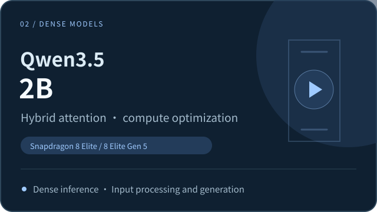

  

<h1 align="center">LuxiInfer</h1>

**Efficient on-device inference for Dense and MoE models, overcoming mobile compute and storage bottlenecks with custom core operators, ultra-low-bit quantization, and dynamic expert scheduling.**

Initial focus: Android · Dense and MoE models · On-device inference

  

[🎬 Live Demos](#demo) · [🚀 Quick Start](#quick-start) · [📰 News](#news) · [⚡ Performance](#performance) · [🧩 Technology](#technology)

[简体中文](README.md) | **English**

**LuxiInfer** is LuxiTech’s high-performance on-device AI inference solution and application. Designed for large models of different architectures and scales, chip platforms, and device scenarios, it brings together model adaptation, operator optimization, low-bit quantization, storage management, and runtime scheduling, with the goal of running more models efficiently across a wider range of devices.

The current phase focuses on Android phones, with initial adaptation and validation completed on Qualcomm mobile platforms. The Android app provides local inference, with initial support for Dense and MoE models from the Qwen series and LuxiTech’s own LuxiLLM models. These support text conversations, and selected models also support image understanding.

- 📱 **One-tap download and offline inference:** Enjoy an out-of-the-box app experience. Select and download a model in the app to start text conversations, or use a model that supports image understanding. Once the model is downloaded, inference runs entirely on the phone without an internet connection, protecting data privacy.
- ⚡ **Custom low-level operators make the most of the NPU:** In the current phase, LuxiInfer targets the Qualcomm Hexagon NPU and uses **custom operators** to optimize computation and data movement. This addresses frequent scheduling and memory-access overhead in hybrid-attention models running on general-purpose frameworks, improving computational efficiency.
- 💾 **Coordinated compute and storage reduce resource use:** Low-bit quantization, dynamic caching, and asynchronous loading are tailored to each model to optimize weight storage, memory usage, and runtime scheduling, making large models practical on phones.
- 🧠 **One solution for multiple model architectures:** The same on-device inference solution supports both Dense and MoE architectures. Users can enjoy fast responses from a 2B model or run a 35B model on a phone for complex text and image-based tasks.

Looking ahead, LuxiInfer will continue to expand support for model architectures, chip platforms, and runtime environments, developing more general on-device operators, quantization, and runtime solutions to bring high-performance local AI to a wider range of devices and use cases.

## 🎬 Live Demos

These demos use Qwen3.5-2B and Qwen3.6-35B-A3B to show input processing, streaming generation, and image-based question answering with Dense and MoE models on a phone.

<table>
  <tr>
    <td width="50%" align="center">
      <!-- DEMO_SMALL_MODEL_URL: Replace with the Dense model demo video URL. -->
      
       <b>Dense · Qwen3.5-2B: Input processing and continuous generation</b>
      
See optimized long-text processing, streaming responses, and inference speed.

    </td>
    <td width="50%" align="center">
      <!-- DEMO_MOE_URL: Replace with the Qwen3.6-35B-A3B demo video URL. -->
      
       <b>MoE · Qwen3.6-35B-A3B: On-device large-model inference</b>
      
See Qwen3.6 answer questions about documents, understand images, and generate responses continuously.

    </td>
  </tr>
</table>

<!-- DEMO_APP_URL: Replace with the full app walkthrough video URL. -->

  

<b>Full app walkthrough: Model library → One-tap download → Load model → On-device chat</b>

## 🚀 Quick Start

### 1. Devices and Models

The following four models are currently available for download. Make sure your phone has enough storage space before downloading:

<table width="100%">
  <thead>
    <tr>
      <th width="21%">
Model
</th>
      <th width="18%">
Parameters
</th>
      <th width="24%">
Capabilities
</th>
      <th width="15%">
Storage required
</th>
      <th width="22%">
Supported devices
</th>
    </tr>
  </thead>
  <tbody>
    <tr>
      <td align="center">LuxiLLM-1.7B</td>
      <td align="center">1.7B</td>
      <td align="center">On-device text inference</td>
      <td align="center">Approx. 1.59 G</td>
      <td align="center" valign="middle" rowspan="4">
Android devices powered by Qualcomm Snapdragon 8 Elite Gen 5
</td>
    </tr>
    <tr>
      <td align="center">Qwen3.5-0.8B (Dense)</td>
      <td align="center">0.8B</td>
      <td align="center">On-device text and image inference</td>
      <td align="center">Approx. 767 MB</td>
    </tr>
    <tr>
      <td align="center">Qwen3.5-2B (Dense)</td>
      <td align="center">2B</td>
      <td align="center">On-device text and image inference</td>
      <td align="center">Approx. 1.8 G</td>
    </tr>
    <tr>
      <td align="center">Qwen3.6-35B-A3B (MoE)</td>
      <td align="center">35B total / approx. 3B active</td>
      <td align="center">On-device text and image inference</td>
      <td align="center">Approx. 10.9 G</td>
    </tr>
  </tbody>
</table>

### 2. Download and Install

<!-- APK_DOWNLOAD_URL: Replace with the Android APK download URL. -->
Download the [**LuxiInfer Android App**](APK_DOWNLOAD_URL), then install and open it on your Android phone.

### 3. Load a Model and Start Chatting

- **Choose a model.** Open the app's model library and select a model for your task.
- **Download and load it.** Download the corresponding model package, then load the model.
- **Start an on-device conversation.** Enter text or an image to try question answering, image understanding, and streaming generation.

An internet connection is required to download a model. Once downloaded, the model can run locally on your phone offline.

## 📰 News

- 📱 **[2026-10-30]** **LuxiInfer-Android v1.0** released, with one-tap model downloads and on-device NPU inference.
- 🚀 **[2026-10-23]** Deployed a **35B-A3B MoE** model on a phone. In tests, **Qwen3.6-35B-A3B MoE** reached **516.661 tokens/s** for text-only prefill and **17.262 tokens/s** for multimodal decode.
- ⚡ **[2026-10-20]** Completed **Dense** model acceleration. In tests with a 4K context, **Qwen3.5-2B** reached **1441.75 tokens/s** for prefill and **50.95 tokens/s** for decode.

## ⚡ Performance

### 🚀 Dense Model Benchmarks: Qwen3.5-0.8B / 2B

With a **4K context**, LuxiInfer achieves the following on **Qualcomm Snapdragon 8 Elite Gen 5**:

- **Qwen3.5-0.8B:** Prefill **1843.58 tokens/s**, decode **90.33 tokens/s**.
- **Qwen3.5-2B:** Prefill **1441.75 tokens/s**, decode **50.95 tokens/s**.

The chart below compares inference speeds for **Qwen3.5-0.8B / 2B** with a **4K context** on **Qualcomm Snapdragon 8 Elite** and **Qualcomm Snapdragon 8 Elite Gen 5**. The upper section shows **prefill (input processing)** and the lower section shows **decode (continuous generation)**, both in tokens/s; **higher is faster**. Blue represents LuxiInfer and gray represents Qualcomm's official solution. Each group shows the measured speeds and their ratio.

These results reflect the combined effect of model operator and full-model execution optimizations.

### 🧠 MoE Model Benchmarks: Qwen3.6-35B-A3B

LuxiInfer delivers high-performance on-device inference for a 35B MoE model **without lookahead expert scheduling or speculative decoding**:

- **Decode up to 17.262 tokens/s.** Supports continuous on-device generation for text questions and image-based interactions.
- **Prefill up to 516.661 tokens/s.** Input processing throughput exceeds 500 tokens/s, speeding up long-input tasks.

> 💾 **35B MoE with low memory usage:** Qwen3.6-35B-A3B runs locally on a **Qualcomm Snapdragon 8 Elite Gen 5** phone with **12 GiB of RAM**, with peak runtime memory usage as low as **approximately 3.8 GiB**.

#### 📊 1024 → 1024 Token Benchmarks

**Test platform: Qualcomm Snapdragon 8 Elite Gen 5; total context: 2048 tokens.** The following results show text-only and multimodal tests under the same configuration, with 1024 input tokens and 1024 output tokens.

| Input type | Input → output tokens | Prefill (tokens/s) | Decode (tokens/s) |
| :---: | :---: | :---: | :---: |
| Text only | 1024 → 1024 | 516.661 | 14.179 |
| Text and image | 1024 → 1024 | 370.344 | 17.262 |

*Time to first response for multimodal tasks also includes image processing and visual encoding.*

## 🧩 Technology

LuxiInfer coordinates optimization of model operators, quantization, storage, and runtime scheduling across different model architectures and device platforms, providing efficient on-device inference for Dense and MoE models. The current version builds on ExecuTorch and Qualcomm’s native AI acceleration stack, with initial Android device support.

### 1. Hybrid Attention: Core Computation and Execution Optimization

Hybrid-attention models use different computational modules to process sequence information, placing demands on on-device operator efficiency, state management, and hardware execution.

LuxiInfer combines custom operators with model execution optimizations tailored to hybrid-attention models, improving mobile inference efficiency through fused computation, state reuse, and hardware acceleration:

- **Operator implementation and fused computation:** Optimize core model computations. For example, execute key recurrent computations and state updates together to reduce operator fragmentation and intermediate tensor transfers.
- **State and memory-access optimization:** Reuse intermediate results and working state to reduce redundant computation and memory access.
- **Hardware acceleration and parallel execution:** Optimize execution for the target platform. The current implementation uses Hexagon vectorization and parallel execution to improve Prefill and Decode efficiency.

The diagram below uses hybrid-attention computation to illustrate one category of operator and execution optimizations.

### 2. MoE Architecture: Expert Computation and Resource Scheduling Optimization

For large-parameter MoE models, expert weight storage and scheduling present deployment challenges. Although only some experts are activated at a time, the full set of weights must still be stored on the device, making **resident memory, expert reads, and loading delays** important factors in mobile inference.

Using Qwen3.6-35B-A3B as an example, LuxiInfer coordinates expert computation, model storage, and resource management through the following optimizations:

- **2-bit expert quantization:** Compress expert weights to reduce model storage and weight transfer overhead.
- **On-demand loading and dynamic caching:** Load and reuse expert weights as needed to reduce resident memory use and repeated reads.
- **Prefill weight reuse:** Optimize expert weight loading and reuse during Prefill to reduce repeated reads and improve computational efficiency.
- **Decode read-compute overlap:** Coordinate weight reads with model computation to reduce loading delays and improve decode efficiency.
- **Resource sharing across stages:** Reuse runtime resources across Prefill and Decode to reduce repeated loading and resource overhead.

## 🤝 Contact and Collaboration

Please use project Issues to report device compatibility, deployment problems, and performance results. When submitting an issue, include your phone / SoC, OS version, app / model version, key settings, and runtime logs.

LuxiTech welcomes technical discussions and collaboration on model adaptation, deployment integration, and performance optimization for phones, edge devices, and local AI applications.

- Technical and business inquiries: [LuxiTech@luxitech.cn](mailto:LuxiTech@luxitech.cn)
- LuxiTech: [GitHub · LuxiTech](https://github.com/LuxiTech)
- Related project: [LuxiChat-App](https://github.com/LuxiTech/LuxiChat-App)

Thanks to the ExecuTorch, Qualcomm AI stack, and Qwen open-source model communities. See the corresponding releases for the sources, versions, and licensing information of models and third-party components.
