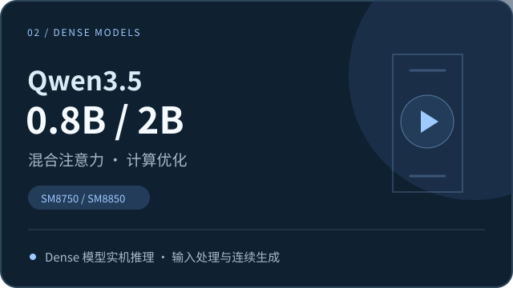
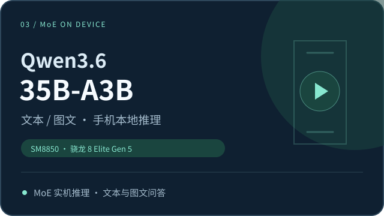
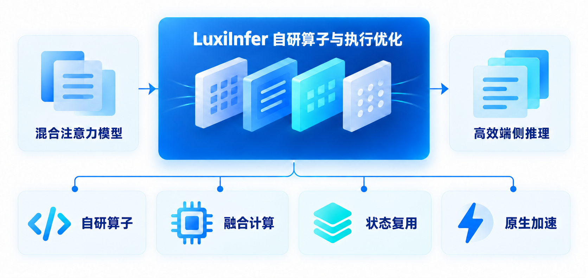
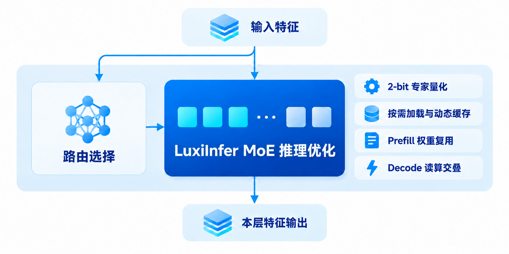

  

<h1 align="center">LuxiInfer</h1>

**面向 Dense 与 MoE 模型的高效端侧 AI 推理，以自研核心算子、超低比特量化和动态专家调度，突破移动端计算与存储瓶颈。**

首阶段聚焦 Android · 支持 Dense 与 MoE 模型 · 本地推理

  

[🎬 实机演示](#demo) · [🚀 快速开始](#quick-start) · [📰 最新动态](#news) · [⚡ 性能表现](#performance) · [🧩 技术方案](#technology)

**简体中文** | [English](README_EN.md)

**LuxiInfer** 是陆兮科技打造的高性能端侧 AI 推理方案与应用，面向不同架构和规模的大模型、芯片平台和终端场景，贯通模型适配、算子优化、低比特量化、存储管理与运行时调度，致力于让更多模型在不同终端设备上高效运行。

当前阶段，LuxiInfer 聚焦 Android 手机，已在高通移动平台完成首批适配与验证，通过 Android App 提供本地推理体验。首批适配 Qwen 系列的 Dense 与 MoE 模型，支持文本对话与图文理解。

- 📱 **一键下载，本地离线运行**：提供开箱即用的 App 体验。在 App 中选择并下载模型后即可开始文本对话与图文交互。模型下载完成后，全流程支持手机本地离线推理，保障数据隐私。
- ⚡ **底层算子自研，高效释放 NPU 算力**：当前阶段面向高通 Hexagon NPU，结合**自研算子**，优化计算和数据搬运，解决混合注意力模型在通用框架下调度频繁、访存开销大的问题，显著提升计算效率。
- 💾 **计算与存储协同，降低资源开销**：根据模型特点，结合低比特量化、动态缓存和异步加载等技术，优化权重存储、内存占用与运行时调度，让大参数模型也能适应手机端资源。
- 🧠 **一套方案，覆盖多种模型架构**：同一套端侧推理方案覆盖 Dense 与 MoE 架构。让用户既能体验 2B 模型的极速响应，也能在手机上跑通 35B 大模型进行复杂的文本问答与图文理解。

未来，LuxiInfer 将持续扩展对不同模型架构、芯片平台与运行环境的适配，推进更通用的端侧算子、量化与运行时解决方案，让高性能本地 AI 能力覆盖更丰富的终端场景。

## 🎬 实机演示

以 Qwen3.5-2B 和 Qwen3.6-35B-A3B 为代表，展示 Dense 与 MoE 模型在手机上的输入处理、流式生成与图文问答。

<table>
  <tr>
    <td width="50%" align="center">
      <!-- DEMO_SMALL_MODEL_URL：替换为 Dense 模型实机视频地址。 -->
      
       <b>Dense · Qwen3.5-2B：输入处理与连续生成</b>
      
查看优化后的长文本处理、流式回答与运行速度。

    </td>
    <td width="50%" align="center">
      <!-- DEMO_MOE_URL：替换为 Qwen3.6-35B-A3B 实机视频地址。 -->
      
       <b>MoE · Qwen3.6-35B-A3B：手机本地大模型推理</b>
      
查看 Qwen3.6 的材料问答、图片理解与持续生成。

    </td>
  </tr>
</table>

<!-- DEMO_APP_URL：替换为 App 完整体验视频地址。 -->

  

<b>App 完整体验：模型库 → 一键下载 → 加载模型 → 本地对话</b>

## 🚀 快速开始

### 1. 设备与模型

目前开放下载以下四款模型，下载前请预留相应的手机存储空间：

<table width="100%">
  <thead>
    <tr>
      <th width="21%">
模型
</th>
      <th width="18%">
参数规模
</th>
      <th width="24%">
支持能力
</th>
      <th width="15%">
所需存储空间
</th>
      <th width="22%">
支持的设备
</th>
    </tr>
  </thead>
  <tbody>
    <tr>
      <td align="center">LuxiLLM-1.7B</td>
      <td align="center">1.7B</td>
      <td align="center">手机本地文本推理</td>
      <td align="center">约 1.59 G</td>
      <td align="center" valign="middle" rowspan="4">
搭载高通 Snapdragon 8 Elite Gen 5 芯片的安卓设备
</td>
    </tr>
    <tr>
      <td align="center">Qwen3.5-0.8B（Dense）</td>
      <td align="center">0.8B</td>
      <td align="center">手机本地文本与图文推理</td>
      <td align="center">约 767 MB</td>
    </tr>
    <tr>
      <td align="center">Qwen3.5-2B（Dense）</td>
      <td align="center">2B</td>
      <td align="center">手机本地文本与图文推理</td>
      <td align="center">约 1.8 G</td>
    </tr>
    <tr>
      <td align="center">Qwen3.6-35B-A3B（MoE）</td>
      <td align="center">35B 总参数 / 约 3B 激活参数</td>
      <td align="center">手机本地文本与图文推理</td>
      <td align="center">约 10.9 G</td>
    </tr>
  </tbody>
</table>

### 2. 下载与安装

<!-- APK_DOWNLOAD_URL：替换为 Android 安装包下载地址。 -->
下载 [**LuxiInfer Android App**](APK_DOWNLOAD_URL)，在 Android 手机上安装并打开。

### 3. 加载模型，开始对话

- **选择模型。** 进入 App 模型库，按任务需要选择模型。
- **一键下载并加载。** 下载配套模型包，完成后加载模型。
- **开始本地对话。** 输入文字或图片，体验文本问答、图片理解与流式生成。

模型下载需要网络；下载完成后，即可在离线状态下使用手机本地推理。

## 📰 最新动态

- 📱 **[2026-10-30]** **LuxiInfer-Android v1.0** 发布，支持模型一键下载与手机 NPU 本地推理。
- 🚀 **[2026-10-23]** 完成 **35B-A3B MoE** 手机端部署，**Qwen3.6-35B-A3B MoE 实测**纯文本 Prefill 达到 **516.661 tokens/s**，图文 Decode 达到 **17.262 tokens/s**。
- ⚡ **[2026-10-20]** 完成 **Dense** 模型加速。实测 **Qwen3.5-2B 在** 4K 上下文下，Prefill 达到 **1441.75 tokens/s**，Decode 达到 **50.95 tokens/s**。

## ⚡ 性能表现

### 🚀 Dense 模型实测：Qwen3.5-0.8B / 2B

在 **4K 上下文**下，LuxiInfer 在 **高通 Snapdragon 8 elite Gen 5** 上实现：

- **Qwen3.5-0.8B：** Prefill **1843.58 tokens/s**，Decode **90.33 tokens/s**。
- **Qwen3.5-2B：** Prefill **1441.75 tokens/s**，Decode **50.95 tokens/s**。

下图汇总 **Qwen3.5-0.8B / 2B** 在 **高通 Snapdragon 8 elite** 与 **高通 Snapdragon 8 elite Gen 5** 平台、**4K 上下文**下的推理速度：上方为 **Prefill（输入处理）**，下方为 **Decode（连续生成）**，单位均为 token/s，**数值越高，速度越快**。蓝色为 LuxiInfer，灰色为高通官方；每组标出实测速度与速度比。

*高通官方数据来源：Qualcomm AI Hub 的 [Qwen3.5-0.8B 性能数据](https://github.com/qualcomm/ai-hub-models/blob/v0.65.0/src/qai_hub_models/models/qwen3_5_0_8b/perf.yaml)和 [Qwen3.5-2B 性能数据](https://github.com/qualcomm/ai-hub-models/blob/v0.65.0/src/qai_hub_models/models/qwen3_5_2b/perf.yaml)。双方设备、量化细节与软件版本存在差异，结果仅用于同档位参考对比；图中速度比按所展示数值计算并四舍五入。*

*图中 Snapdragon 8 Elite 数据为性能测试结果，当前 App 的设备支持范围请以[设备与模型](#supported)表为准。*

上述结果体现了模型算子与整模执行路径的协同优化效果。

### 🧠 MoE 模型实测：Qwen3.6-35B-A3B

在**不使用前瞻专家调度与投机解码技术**的情况下，LuxiInfer 实现高性能的手机端 35B MoE 推理：

-  **Decode 最高 17.262 tokens/s。** 支持手机本地连续生成，满足文本问答与图文交互需求。
-  **Prefill 最高 516.661 tokens/s。** 输入处理吞吐突破 500 tokens/s，加快长输入任务的处理。

> 💾 **35B MoE，低内存部署：** Qwen3.6-35B-A3B 在一台配备 **12 GiB 运行内存**的 **高通 Snapdragon 8 elite Gen 5** 手机上本地运行，且峰值运行内存低至 **约 3.8 GiB**。

#### 📊 1024 → 1024 token 实测

**测试平台：高通 Snapdragon 8 elite Gen 5；总上下文：2048 token。** 以下展示同一配置下的纯文本与图文实测结果，输入与输出长度均为 1024 token。

| 输入类型 | 输入 → 输出 token | Prefill（tokens/s） | Decode（tokens/s） |
| :---: | :---: | :---: | :---: |
| 纯文本 | 1024 → 1024 | 516.661 | 14.179 |
| 图文 | 1024 → 1024 | 370.344 | 17.262 |

*图文任务的首次响应还包含图片处理与视觉编码时间。*

#### 📰 高通官方端侧 MoE 吞吐参考

| 方案 | 模型 | 芯片平台 | 执行后端 | Prefill（tokens/s） |
| :---: | :---: | :---: | :---: | :---: |
| **LuxiInfer** | Qwen3.6-35B-A3B | Snapdragon 8 elite Gen 5 | Hexagon NPU | **516.661** |
| [**高通官方方案**](https://www.qualcomm.cn/news/releases/2026/09/releases-2026-09-22-2) | StepEdge-Omni 30B-MoE | Snapdragon 8 Elite Extreme Gen 6 | NPU + GPU | **> 330** |

*LuxiInfer 数据来自纯文本 1024 → 1024 token 场景；两者芯片平台、模型与执行配置不同，数据仅用于吞吐量级参考。*

## 🧩 技术方案

LuxiInfer 面向不同模型架构和终端平台，协同优化模型算子、量化、存储与运行时调度，为 Dense 与 MoE 模型提供高效的端侧推理能力。当前版本基于 ExecuTorch 和高通原生 AI 加速技术栈，完成首批 Android 设备适配。

### 1. 混合注意力：核心计算与执行优化

混合注意力模型通过不同的计算模块处理序列信息，对端侧算子效率、状态管理和硬件执行能力提出了较高要求。

LuxiInfer 面向混合注意力模型的计算特点，结合自研算子与模型执行优化，围绕计算融合、状态复用和硬件加速等方向，提升模型在手机端的推理效率：

- **算子实现与计算融合：** 针对模型中的核心计算进行优化；例如，将关键递推计算与状态更新统一执行，减少算子拆分和中间张量搬运。
- **状态与访存优化：** 复用中间结果与工作状态，降低重复计算和内存读写开销。
- **硬件加速与并行：** 结合目标平台的硬件能力优化执行；当前实现利用 Hexagon 向量化与并行执行能力，提高 Prefill 和 Decode 的执行效率。

下图以混合注意力计算为例，展示其中一类算子与执行优化。

### 2. MoE 架构：专家计算与资源调度优化

在混合注意力核心计算优化的基础上，MoE 模型带来了新的部署挑战：虽然每次只激活部分专家，但完整权重仍需存放在设备上。模型规模增大后，**常驻内存、专家读取与加载等待**成为影响手机端推理的重要因素。

以 Qwen3.6-35B-A3B 为例，LuxiInfer 协同优化专家计算、模型存储与资源管理，重点包括：

- **2-bit 专家量化：** 压缩专家权重，降低模型存储占用和权重传输开销。
- **按需加载与动态缓存：** 根据运行需求加载和复用专家权重，降低常驻内存占用与重复读取开销。
- **Prefill 权重复用：** 优化 Prefill 阶段的专家权重加载与复用，减少重复读取，提高计算效率。
- **Decode 读算交叠：** 协同专家权重读取与模型计算，减少加载等待，提升 Decode 阶段的执行效率。
- **跨阶段资源共享：** 复用 Prefill 与 Decode 阶段的运行资源，减少重复加载和资源开销。

## 🤝 交流与合作

欢迎通过项目 Issues 反馈机型适配、部署问题和性能记录。提交问题时请附手机 / SoC、系统版本、App / 模型版本、关键配置及运行日志。

面向手机、边缘设备与本地 AI 应用，陆兮科技提供模型适配、部署集成与性能优化的技术交流与合作。

- 技术交流与商务合作：[LuxiTech@luxitech.cn](mailto:LuxiTech@luxitech.cn)
- 陆兮科技：[GitHub · LuxiTech](https://github.com/LuxiTech)
- 相关项目：[LuxiChat-App](https://github.com/LuxiTech/LuxiChat-App)

感谢 ExecuTorch、Qualcomm AI 技术栈及 Qwen 开源模型社区。模型与第三方组件的来源、版本及许可说明见对应发布物。
